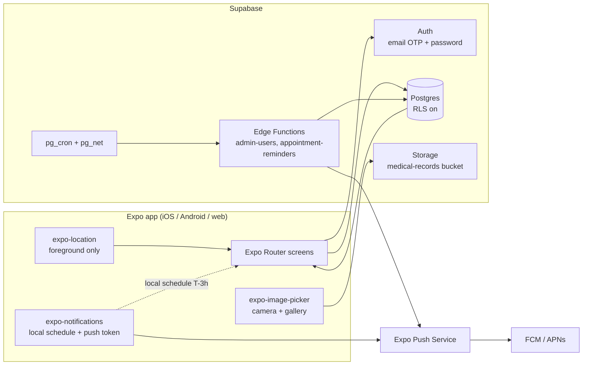

# Product Requirements Document (PRD)
# SIM Klinik Kecantikan — LuxeDerm

**Versi:** 1.0
**Tanggal:** 21 November 2026
**Turunan dari:** `SRS_SIM_Klinik_Kecantikan (1).md` v0.1
**Platform:** Expo / React Native (Android, iOS, web) — single codebase
**Backend:** Supabase (Postgres + Auth + Storage + Edge Functions + pg_cron)

---

## 1. Ringkasan Produk

Aplikasi mobile-first untuk klinik kecantikan single-cabang yang menggantikan proses booking manual (chat/telepon) dengan:

1. **Booking treatment self-service** — pilih dokter/beautician + slot, tanpa double-booking.
2. **Rekam Medis Elektronik (RME)** — dokter mengisi diagnosa, resep, dan **foto before/after langsung dari kamera/galeri perangkat**.
3. **Temukan klinik terdekat** — akses lokasi perangkat untuk menghitung jarak & membuka navigasi.
4. **Reminder push notification** — pasien diberi notifikasi otomatis **3 jam sebelum** jadwal.
5. **Operasional & reporting** — kasir, stok, invoice, dashboard admin (dari SRS §2.4–2.6).

Dokumen ini menerjemahkan requirement SRS menjadi keputusan produk, skema data Supabase, kontrak API, dan kriteria penerimaan yang bisa langsung dieksekusi.

---

## 2. Keputusan Scope (hasil rekonsiliasi dengan SRS)

| # | Isu SRS | Keputusan PRD | Alasan |
|---|---|---|---|
| D1 | SRS §1.2 menetapkan **single-cabang** | Tabel `clinics` tetap dibuat, tetapi **hanya 1 baris aktif** di MVP | Fitur "klinik terdekat" butuh entitas lokasi. Satu baris = jarak pasien → klinik. Skema siap multi-cabang tanpa migrasi ulang. |
| D2 | Landing page berbasis web (FR-LP-09) | Landing page tetap di **web build** (`expo start --web`, static export) | SRS §2.1 fokus SEO & akuisisi; app mobile fokus booking/RME. Satu repo, dua surface. |
| D3 | FR-LP-06 map embed | Web: iframe/`Linking` ke Google Maps. Mobile: `expo-location` + deep link navigasi | Map embed di web tidak butuh izin lokasi; di mobile butuh jarak relatif. |
| D4 | FR-AUTH-01 "email/HP + OTP" | **Supabase Auth email OTP** (magic link/6-digit) untuk MVP; login password untuk staf | Supabase Auth sudah menangani OTP + rate limit (NFR-03). Nomor HP hanya data profil. |
| D5 | FR-AUTH-04 non-self-register staf | Akun staf dibuat via `admin.createUser` di **Edge Function** (bukan RLS) | Service role key tidak boleh ada di client. |
| D6 | FR-USR-08 "email/WA/push" | MVP: **push (Expo)** + email transaksional. WA ditunda | Tidak ada integrasi eksternal di MVP (SRS §1.2). |
| D7 | FR-DOK-05 foto before/after | Kamera/galeri → **Supabase Storage bucket privat** + consent record wajib | NFR-01 (enkripsi) & etika foto medis. |
| D8 | SRS §6 open questions | Default diambil di §11 dan harus dikonfirmasi owner | Menghindari blocking desain. |

---

## 3. Aktor & Matriks RBAC

Role disimpan di `profiles.role` dan ditegakkan **di database** (RLS), bukan hanya di UI — NFR-02.

| Kapabilitas | patient | employee | doctor | admin |
|---|---|---|---|---|
| Landing page publik | ✅ | ✅ | ✅ | ✅ |
| Booking / cancel booking sendiri | ✅ | – | – | – |
| Lihat slot dokter real-time | ✅ | ✅ | ✅ | ✅ |
| Lihat rekam medis pasien | hanya miliknya | ❌ | ✅ (pasien yang dijadwalkan) | ✅ (read-only, audited) |
| Tulis rekam medis + foto | ❌ | ❌ | ✅ | ❌ |
| Kasir / invoice / stok | ❌ | ✅ | ❌ | ✅ |
| Data finansial (revenue, invoice) | hanya invoice sendiri | ✅ | ❌ | ✅ |
| Master data (treatment, harga, promo) | read-only | read-only | read-only | ✅ |
| Audit log | ❌ | ❌ | ❌ | ✅ |

Implementasi: `public.app_role()` (SECURITY DEFINER, `select role from profiles where id = auth.uid()`) dipakai di semua policy. Staf & dokter **tidak** bisa membaca tabel finansial; dokter **tidak** bisa membaca `invoices` sama sekali.

---

## 4. Arsitektur Sistem



**Prinsip:** client hanya boleh bicara ke Supabase dengan anon/publishable key; semua operasi sensitif (buat akun staf, kirim push massal) lewat Edge Function dengan `service_role`.

---

## 5. Model Data Supabase

Semua tabel di schema `public`, `created_at/updated_at` default `now()`, RLS **enabled** di setiap tabel tanpa kecuali.

### 5.1 Enum

```sql
create type public.user_role          as enum ('patient', 'employee', 'doctor', 'admin');
create type public.appointment_status as enum ('pending', 'confirmed', 'completed', 'cancelled', 'no_show');
create type public.payment_status     as enum ('unpaid', 'dp_paid', 'paid', 'refunded');
create type public.attachment_kind    as enum ('before', 'after', 'document');
create type public.stock_move_kind    as enum ('in', 'out', 'adjustment');
```

### 5.2 Identitas

```sql
create table public.profiles (
  id          uuid primary key references auth.users on delete cascade,
  role        public.user_role not null default 'patient',
  full_name   text not null,
  phone       text,
  dob         date,
  created_at  timestamptz not null default now(),
  updated_at  timestamptz not null default now()
);

create table public.patient_details (      -- FR-USR-01
  patient_id      uuid primary key references public.profiles(id) on delete cascade,
  allergies       text[] default '{}',     -- terenkripsi at-rest oleh Postgres TDE/disk
  medical_history text,
  emergency_name  text,
  emergency_phone text
);

create table public.doctor_profiles (      -- FR-LP-03, FR-KRY-06
  doctor_id    uuid primary key references public.profiles(id) on delete cascade,
  specialty    text not null,
  bio          text,
  avatar_path  text,                       -- storage: public bucket 'doctors'
  is_active    boolean not null default true
);

create table public.employee_profiles (
  employee_id uuid primary key references public.profiles(id) on delete cascade,
  job_title   text not null
);
```

`profiles.role` hanya bisa diubah oleh admin: trigger `protect_role_change` menolak `update` dari role `authenticated` bila `role` berubah.

### 5.3 Katalog & Jadwal

```sql
create table public.treatments (           -- FR-LP-02, FR-ADM-01
  id             uuid primary key default gen_random_uuid(),
  name           text not null,
  category       text not null,
  description    text,
  duration_min   int  not null,
  price_idr      int  not null,
  is_active      boolean not null default true
);

create table public.doctor_treatments (    -- dokter mana bisa treatment apa
  doctor_id    uuid references public.doctor_profiles(doctor_id) on delete cascade,
  treatment_id uuid references public.treatments(id) on delete cascade,
  primary key (doctor_id, treatment_id)
);

create table public.doctor_schedules (     -- jam praktik berulang
  id          uuid primary key default gen_random_uuid(),
  doctor_id   uuid references public.doctor_profiles(doctor_id) on delete cascade,
  weekday     int  not null check (weekday between 0 and 6),  -- 0 = Minggu
  start_time  time not null,
  end_time    time not null,
  slot_min    int  not null default 30,
  check (start_time < end_time)
);

create table public.schedule_exceptions (  -- cuti / libur (menggantikan DOCTOR_OFF_DAYS di src/utils/data.ts)
  id         uuid primary key default gen_random_uuid(),
  doctor_id  uuid references public.doctor_profiles(doctor_id) on delete cascade,
  off_date   date not null,
  reason     text,
  unique (doctor_id, off_date)
);
```

**Slot real-time (FR-USR-03)** tidak disimpan sebagai tabel slot. Slot = irisan `doctor_schedules` − `schedule_exceptions` − `appointments` aktif, dihitung oleh RPC `public.available_slots(doctor_id, from_date, to_date)`.

### 5.4 Booking

```sql
create table public.appointments (         -- FR-USR-02..06, FR-KRY-01/02
  id             uuid primary key default gen_random_uuid(),
  patient_id     uuid references public.profiles(id)   not null,
  doctor_id      uuid references public.doctor_profiles(doctor_id) not null,
  treatment_id   uuid references public.treatments(id) not null,
  starts_at      timestamptz not null,     -- waktu absolut, bukan offset
  ends_at        timestamptz not null,
  status         public.appointment_status not null default 'pending',
  dp_amount_idr  int not null default 0,
  source         text not null default 'app',  -- 'app' | 'walk_in' (FR-KRY-07)
  cancellation_reason text,
  reminder_sent_at    timestamptz,         -- dedupe push T-3h
  created_by     uuid references public.profiles(id),
  created_at     timestamptz not null default now(),
  updated_at     timestamptz not null default now(),
  check (ends_at > starts_at)
);

-- NFR-06: double-booking dicegah di level database, bukan di UI.
create unique index appointments_no_double_booking
  on public.appointments (doctor_id, starts_at)
  where status in ('pending', 'confirmed');
```

`dayIndex`/`slot` string di `src/app/user/index.tsx` diganti `starts_at` absolut saat backend aktif. Reminder push dihitung dari `starts_at` (lihat §8).

### 5.5 Rekam Medis (append-only)

FR-DOK-08 melarang edit/hapus. Struktur: header per kunjungan + revisi immutable.

```sql
create table public.medical_records (
  id             uuid primary key default gen_random_uuid(),
  appointment_id uuid unique references public.appointments(id) on delete restrict,
  patient_id     uuid references public.profiles(id) not null,
  doctor_id      uuid references public.doctor_profiles(doctor_id) not null,
  created_at     timestamptz not null default now()
);

create table public.medical_record_revisions (
  id            uuid primary key default gen_random_uuid(),
  record_id     uuid references public.medical_records(id) on delete restrict,
  version       int  not null,
  diagnosis     text,
  notes         text,
  prescription  jsonb,        -- [{product_id?, name, dose, frequency, duration_days}]
  follow_up_at  timestamptz,  -- FR-DOK-06
  needs_approval boolean not null default false,  -- FR-DOK-07
  created_by    uuid references public.profiles(id) not null,
  created_at    timestamptz not null default now(),
  unique (record_id, version)
);

create table public.medical_record_attachments (  -- FR-DOK-05, FR-LP-04
  id          uuid primary key default gen_random_uuid(),
  record_id   uuid references public.medical_records(id) on delete restrict,
  storage_path text not null,     -- 'medical-records/{patient_id}/{record_id}/{uuid}.jpg'
  kind        public.attachment_kind not null,
  consent_id  uuid,              -- wajib untuk kind in ('before','after')
  captured_at timestamptz not null default now(),
  created_by  uuid references public.profiles(id) not null
);

create table public.photo_consents (           -- consent form tercatat (FR-LP-04)
  id          uuid primary key default gen_random_uuid(),
  patient_id  uuid references public.profiles(id) not null,
  scope       text not null,      -- 'internal_record' | 'public_gallery'
  signed_at   timestamptz not null default now(),
  revoked_at  timestamptz
);
```

RLS: `medical_record_revisions` hanya `select` + `insert`; **`update`/`delete` tidak dibuatkan policy** sehingga ditolak untuk semua role non-service.

### 5.6 Kasir, Stok, Promo

```sql
create table public.invoices (
  id            uuid primary key default gen_random_uuid(),
  appointment_id uuid references public.appointments(id),
  patient_id    uuid references public.profiles(id) not null,
  subtotal_idr  int not null,
  discount_idr  int not null default 0,
  total_idr     int not null,
  payment_status public.payment_status not null default 'unpaid',
  method        text,                       -- 'cash' | 'card' | 'transfer' (offline)
  issued_by     uuid references public.profiles(id),
  issued_at     timestamptz not null default now()
);

create table public.invoice_items (
  id         uuid primary key default gen_random_uuid(),
  invoice_id uuid references public.invoices(id) on delete cascade,
  treatment_id uuid references public.treatments(id),
  product_id   uuid references public.products(id),
  qty        int not null default 1,
  unit_price_idr int not null
);

create table public.products (
  id            uuid primary key default gen_random_uuid(),
  name          text not null,
  sku           text unique,
  stock         int not null default 0,
  min_stock     int not null default 5,     -- FR-KRY-04 alert
  price_idr     int not null
);

create table public.stock_movements (
  id         uuid primary key default gen_random_uuid(),
  product_id uuid references public.products(id) on delete cascade,
  kind       public.stock_move_kind not null,
  qty        int not null,
  note       text,
  created_by uuid references public.profiles(id),
  created_at timestamptz not null default now()
);

create table public.promos (                -- FR-ADM-05
  id          uuid primary key default gen_random_uuid(),
  code        text unique not null,
  kind        text not null,                -- 'percent' | 'amount'
  value       int not null,
  valid_from  date not null,
  valid_until date not null,
  is_active   boolean not null default true
);

create table public.reviews (               -- FR-USR-09
  id             uuid primary key default gen_random_uuid(),
  appointment_id uuid unique references public.appointments(id),
  patient_id     uuid references public.profiles(id) not null,
  rating         int not null check (rating between 1 and 5),
  comment        text,
  is_published   boolean not null default false,   -- moderasi admin
  created_at     timestamptz not null default now()
);
```

### 5.7 Lokasi Klinik (fitur "klinik terdekat")

```sql
create table public.clinics (
  id            uuid primary key default gen_random_uuid(),
  name          text not null,
  address       text not null,
  phone         text,
  lat           double precision not null,
  lng           double precision not null,
  opening_hours jsonb not null,   -- {"mon":[["09:00","20:00"]], ...}
  is_active     boolean not null default true
);
```

MVP mengisi **1 baris**. Query "terdekat" memakai RPC:

```sql
create or replace function public.nearest_clinics(
  user_lat double precision,
  user_lng double precision
) returns table (id uuid, name text, address text, distance_km double precision)
language sql stable as $$
  select c.id, c.name, c.address,
         6371 * acos(
           cos(radians(user_lat)) * cos(radians(c.lat)) *
           cos(radians(c.lng) - radians(user_lng)) +
           sin(radians(user_lat)) * sin(radians(c.lat))
         ) as distance_km
  from public.clinics c
  where c.is_active
  order by distance_km
  limit 5;
$$;
```

### 5.8 Push Token, Audit, CMS

```sql
create table public.push_tokens (          -- §8
  user_id     uuid references public.profiles(id) on delete cascade,
  token       text primary key,            -- ExponentPushToken[...]
  platform    text not null,               -- 'ios' | 'android'
  last_seen_at timestamptz not null default now()
);

create table public.audit_log (            -- NFR-10, FR-AUTH-05, FR-ADM-07
  id         bigint generated always as identity primary key,
  actor_id   uuid,
  actor_role public.user_role,
  action     text not null,                -- 'appointment.cancel', 'record.insert', ...
  entity     text not null,
  entity_id  uuid,
  diff       jsonb,
  created_at timestamptz not null default now()
);

create table public.site_content (         -- FR-ADM-08 (CMS ringan: testimoni, galeri, artikel)
  id         uuid primary key default gen_random_uuid(),
  kind       text not null,                -- 'testimonial' | 'gallery' | 'article'
  payload    jsonb not null,
  is_published boolean not null default false,
  updated_at timestamptz not null default now()
);
```

`audit_log` ditulis lewat trigger database (`after insert/update on appointments, medical_record_revisions, invoices`), bukan dari client — mencegah audit gap.

### 5.9 Ringkasan RLS

| Tabel | patient | employee | doctor | admin |
|---|---|---|---|---|
| `profiles` | select/update self | select self + all patients | select self | all |
| `patient_details` | select/update self | insert/select (walk-in) | select assigned | all |
| `appointments` | select/insert/update self | all | select where `doctor_id = auth.uid()` | all |
| `medical_records*` | select if `patient_id = auth.uid()` | ❌ | insert/select if assigned | select (audited) |
| `invoices` | select self | all | ❌ | all |
| `products/stock_movements` | ❌ | all | ❌ | all |
| `reviews` | insert/select self | ❌ | ❌ | moderasi |
| `push_tokens` | insert/select/delete self | self | self | all |
| `clinics`, `treatments`, `doctor_profiles`, `site_content` | select (published) | select | select | all |

### 5.10 Storage Buckets

| Bucket | Public | Path | Policy |
|---|---|---|---|
| `medical-records` | ❌ | `{patient_id}/{record_id}/{uuid}.jpg` | write/read: dokter penanggung jawab + pasien + admin |
| `gallery` | ✅ read | `{consent_id}/{uuid}.jpg` | write: admin/dokter, hanya bila `photo_consents.scope='public_gallery'` aktif |
| `doctors` | ✅ read | `{doctor_id}.jpg` | write: admin |
| `invoices` | ❌ | `{patient_id}/{invoice_id}.pdf` | read: pasien + karyawan |

Akses ke `medical-records` **hanya via signed URL** (TTL 60 detik). Tidak ada URL publik permanen untuk foto medis.

---

## 6. Fitur per Modul (dengan Acceptance Criteria)

### 6.1 Booking (FR-USR-02..06)

- Ambil slot lewat `rpc.available_slots`; UI mem-filter slot yang lewat untuk hari ini.
- Submit → `insert appointments`; unique index menolak bentrok dengan error `23505` → UI menampilkan "slot sudah diambil" dan refresh.
- Reschedule = `update starts_at` selama status `pending`/`confirmed` dan `now() < starts_at - cancel_window`.
- Cancel = `update status='cancelled'`; reminder yang sudah terjadwal dibatalkan di device.

**AC:** dua pasien tidak bisa memegang `(doctor_id, starts_at)` yang sama; booking aktif selalu punya reminder terjadwal atau `reminder_sent_at` terisi.

### 6.2 Rekam Medis + Foto dari Perangkat (FR-DOK-02..08)

Alur dokter:

1. Buka jadwal hari ini → pilih pasien → `medical_records` (dibuat sekali per appointment).
2. Form diagnosa/resep → `insert medical_record_revisions` (version = max+1).
3. **Ambil foto**: `expo-image-picker.launchCameraAsync` atau `launchImageLibraryAsync` (`mediaTypes: ['images']`, `allowsEditing: true`, `quality: 0.7`).
4. Wajib pilih consent pasien untuk `kind='before'|'after'`; bila tidak ada `photo_consents` aktif → tombol simpan foto disabled.
5. Upload ke bucket `medical-records` via `supabase.storage.from(...).upload(path, blob)`, lalu `insert medical_record_attachments`.
6. Riwayat revisi tampil read-only; edit = revisi baru, bukan overwrite.

**AC:** tidak ada jalur UI maupun policy DB yang bisa `update`/`delete` baris revisi; foto tanpa consent tidak pernah masuk bucket `gallery`; foto medis tidak dapat diakses tanpa sesi dokter/pasien yang berhak.

### 6.3 Klinik Terdekat (FR-LP-06)

- **Mobile:** `expo-location.requestForegroundPermissionsAsync()` → `getCurrentPositionAsync({ accuracy: Balanced })` → `rpc.nearest_clinics` → tampilkan jarak (km) + tombol "Buka di Maps" (`Linking.openURL` skema `geo:` / `maps:`).
- **Web:** tidak meminta izin; tampilkan alamat + link Google Maps (tidak ada perhitungan jarak sisi client).
- Izin ditolak → tetap tampil alamat & jam operasional, tanpa jarak. Fitur tidak boleh dead-end.
- Konfigurasi `expo-location` plugin wajib menyertakan `locationWhenInUsePermission` berbahasa manusia. **Tidak** memakai background location (tidak ada kebutuhan & menaikkan risiko privasi).

**AC:** dengan GPS aktif, jarak klinik tampil dan akurat ±50 m; dengan izin ditolak, UI tetap menampilkan alamat & jam buka tanpa error.

### 6.4 Operasional Karyawan (FR-KRY-01..07)

- Daftar booking harian = `appointments` join `profiles`, `treatments`.
- Check-in → `status='confirmed'` + `checked_in_at` (kolom tambahan di `appointments`).
- Kasir: `invoices` + `invoice_items`, pembayaran offline (`method`), DP mengikuti kebijakan §11.
- Stok: `stock_movements` insert → trigger `products.stock` update; alert bila `stock <= min_stock`.

### 6.5 Admin (FR-ADM-01..08)

- CRUD master data via tabel Supabase + RLS admin.
- Dashboard: SQL view `revenue_daily`, `treatment_popularity`, `doctor_occupancy`.
- Export Excel/PDF: Edge Function `report-export` (CSV/PDF) — bukan di client.
- CMS ringan: `site_content` (testimoni, galeri, artikel) diedit dari layar admin.

---

## 7. Auth & Sesi (FR-AUTH-01..06)

| Requirement | Implementasi |
|---|---|
| Registrasi pasien + OTP | `supabase.auth.signInWithOtp({ email })`; trigger `handle_new_user` membuat `profiles` role `patient` |
| Login 4 role + RBAC | Satu pintu login; role dibaca dari `profiles` → redirect: `patient→/user`, `doctor→/doctor`, `employee→/employee`, `admin→/admin` |
| Reset password | `supabase.auth.resetPasswordForEmail` + deep link `clinic://reset-password` |
| Buat akun staf | Edge Function `admin-users` (verify JWT admin → `auth.admin.createUser`) |
| Audit login | `auth.audit_log_entries` + `audit_log` app-level |
| Auto-logout idle | Session listener client: idle 15 menit (dokter/admin) → `signOut()`; `appState` listener saat app kembali foreground |
| Session storage | `AsyncStorage` (default Supabase). Dokter/admin: pertimbangkan SecureStore (lihat `LargeSecureStore` di docs Supabase) |

---

## 8. Push Notification Reminder (FR-USR-08) — T-3 Jam

### 8.1 Keputusan

Reminder dikirim **3 jam sebelum `appointments.starts_at`** (konstanta `REMINDER_LEAD_HOURS = 3`). Dua jalur, keduanya wajib ada:

| Jalur | Kapan | Kenapa |
|---|---|---|
| **Local schedule** (`expo-notifications.scheduleNotificationAsync` + trigger `DATE`) | Saat booking dibuat di device | Tidak butuh server/FCM; tetap jalan offline; jadi fallback utama MVP |
| **Remote push** (Expo Push Service via Edge Function) | Saat `starts_at` diubah oleh staf, atau booking dibuat di web/kasir | Device belum pernah melihat appointment tersebut |

Dedupe remote: kolom `appointments.reminder_sent_at` (diisi setelah kirim).

### 8.2 Kontrak client (`src/utils/notifications.ts`)

- `setNotificationHandler` di module scope: `shouldShowBanner: true`, `shouldShowList: true`, `shouldPlaySound: true` (Android: `shouldPlaySound:false` menyembunyikan heads-up).
- Channel Android `appointment-reminders` (`AndroidImportance.HIGH`, vibration) dibuat sebelum meminta izin.
- Izin: `getPermissionsAsync()` → `requestPermissionsAsync()` bila belum granted. Ditolak = reminder dilewati, UI tetap sukses booking.
- Jadwal: `trigger: { type: DATE, date: startsAt - 3h, channelId: 'appointment-reminders' }`.
- Guard: `Platform.OS === 'web'` → no-op; tanggal di masa lalu → no-op (jangan throw ke UI).
- Deep link: `content.data.url = "/user"`; `_layout.tsx` mendengarkan `addNotificationResponseReceivedListener` + `getLastNotificationResponse()` lalu `router.push(url)`.

### 8.3 Remote push (server)

1. Device: `getExpoPushTokenAsync({ projectId })` → upsert `push_tokens(user_id, token, platform)`; hapus token saat logout.
2. `pg_cron` tiap 15 menit → `net.http_post` ke Edge Function `appointment-reminders` (secret via Vault, `verify_jwt` off + `auth: 'secret'`):

```sql
select cron.schedule(
  'appointment-reminders-every-15-min',
  '*/15 * * * *',
  $$
  select net.http_post(
    url := (select decrypted_secret from vault.decrypted_secrets where name = 'project_url')
           || '/functions/v1/appointment-reminders',
    headers := jsonb_build_object('Content-type', 'application/json',
      'apikey', (select decrypted_secret from vault.decrypted_secrets where name = 'secret_key')),
    body := '{}'::jsonb
  );
  $$
);
```

3. Function memilih `appointments` dengan `starts_at between now()+interval '2 hours 45 minutes' and now()+interval '3 hours 15 minutes'` dan `reminder_sent_at is null` → POST `https://exp.host/--/api/v2/push/send` (batch ≤100, payload ≤4096 byte).
4. Tangani error: `DeviceNotRegistered` → `delete from push_tokens`; `429/5xx` → exponential backoff; `TOO_MANY_REQUESTS` (>600/detik/project) → throttle.
5. Set `reminder_sent_at = now()` hanya untuk ticket `status: 'ok'`.

### 8.4 Acceptance criteria

- Booking 5 jam dari sekarang → notifikasi muncul ±1 menit dari T-3h, judul memuat nama treatment, body memuat dokter + jam.
- Booking <3 jam dari sekarang → **tidak** menjadwalkan reminder lampau; UI menampilkan "reminder too close to schedule, datang tepat waktu" (tanpa error).
- Izin notifikasi ditolak → booking tetap berhasil, UI menampilkan reminder tidak aktif.
- Reschedule → reminder lama dibatalkan, reminder baru terjadwal di T-3h baru.
- Cancel → reminder dibatalkan; pasien tidak menerima notifikasi untuk slot yang sudah dibatalkan.

---

## 9. Pemetaan NFR

| NFR | Implementasi |
|---|---|
| NFR-01 enkripsi at-rest & in-transit | Supabase Postgres disk encryption + TLS; bucket privat + signed URL; sesi dokter/admin di SecureStore |
| NFR-02 RBAC ketat | RLS per tabel (§5.9); dokter tidak punya policy `invoices` |
| NFR-03 hash & rate limit | Supabase Auth (bcrypt + rate limit bawaan); tidak ada password custom di tabel |
| NFR-04 UU PDP / RME | Consent table, audit append-only, retensi 5 tahun, right-to-erasure via anonimisasi (bukan `delete` rekam medis) |
| NFR-05 landing <3s | Web static export Expo Router + `expo-image`; data landing dari `site_content` di-cache |
| NFR-06 no double-booking | Unique partial index `appointments_no_double_booking` + RPC slot |
| NFR-08 minim klik | Dokter: jadwal → pasien → form (≤3 tap); kasir: satu layar transaksi |
| NFR-09 uptime 99% | Supabase managed + retry pada mutation; optimistic UI |
| NFR-10 auditability | Trigger `audit_log` untuk appointment/rekam medis/invoice |
| NFR-12 backup | Supabase daily backup (PITR bila plan mendukung) + export mingguan |

---

## 10. Fase Delivery

| Fase | Isi | Exit criteria |
|---|---|---|
| **1. Landing page** (FR-LP-*) | Web build dari `src/app/index.tsx`; konten dari `site_content` | Lighthouse mobile ≥ 90, load < 3 s |
| **2. Auth & booking** (FR-AUTH-*, FR-USR-01..06) | Supabase Auth, tabel profil, `available_slots`, `appointments` | Tidak bisa double-booking; reminder T-3h terjadwal |
| **2b. Klinik terdekat** (FR-LP-06) | `expo-location` + `nearest_clinics` | Jarak tampil; izin ditolak tetap usable |
| **3. Operasional** (FR-KRY-*) | Kasir, stok, invoice, walk-in | Satu transaksi end-to-end termasuk stok berkurang |
| **4. RME** (FR-DOK-*) | Revisi append-only, foto kamera/galeri + consent | Upload foto medis hanya lewat signed URL |
| **5. Admin & reporting** (FR-ADM-*) | Dashboard, export, audit viewer | Revenue harian cocok dengan `invoices` |
| **6. Lanjutan** | Payment gateway, CMS penuh, multi-cabang | – |

---

## 11. Default Keputusan untuk Open Questions (SRS §6)

| Pertanyaan | Default PRD | Catatan |
|---|---|---|
| Kebijakan cancel/reschedule | Bebas sampai **H-24**; H-24 s/d H-3 kena potongan DP 50%; < H-3 tidak bisa cancel | Konstanta server-side, bukan client |
| DP wajib/opsional | **Wajib 30%** untuk treatment > Rp 500.000, opsional di bawah itu | Dicatat `dp_amount_idr`, dibayar offline |
| Consent foto before/after | Consent terpisah per foto, default `internal_record`; publik hanya bila pasien setuju `public_gallery` | Revokasi menghapus foto dari `gallery` |
| Struktur harga | Harga tetap per treatment; paket = `treatments.category='package'` | Custom per pasien ditunda |
| Multi-bahasa | **Indonesia saja**; string disiapkan untuk i18n (tidak diaktifkan) | – |

Semua default harus dikonfirmasi owner/dokter penanggung jawab sebelum Fase 3.

---

## 12. Risiko

| Risiko | Dampak | Mitigasi |
|---|---|---|
| Reminder lokal hilang bila app di-uninstall / device reboot sebelum trigger | Pasien tidak dapat pengingat | Remote push T-3h sebagai jalur kedua (§8.3) |
| Foto medis bocor lewat URL | Pelanggaran UU PDP | Bucket privat, signed URL 60 s, policy per record |
| Dobel booking saat offline | Jadwal bentrok | Server-side unique index; client menampilkan error `23505` & refresh slot |
| `expo-notifications` tidak jalan di Expo Go Android (SDK 53+) | QA tidak bisa uji push | Development build (`npx expo run:android` / EAS) untuk QA; local notification tetap bisa diuji di iOS Expo Go |
| Rate limit Expo Push 600/detik/project | Reminder telat | Batch 100 + throttle di Edge Function |

---

## 13. Di Luar Scope MVP

Payment gateway online, WhatsApp Business API, akuntansi eksternal, multi-cabang aktif, telemedicine, loyalty point.
